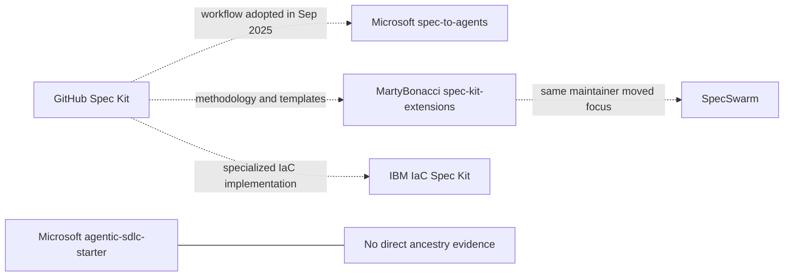
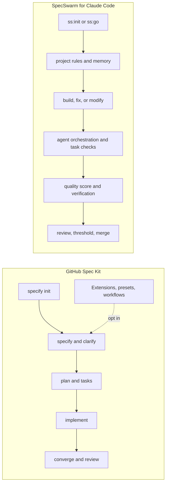
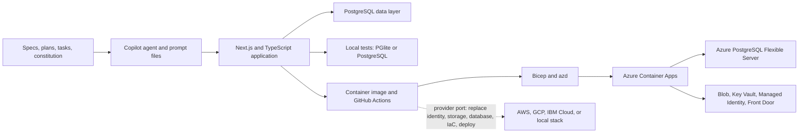
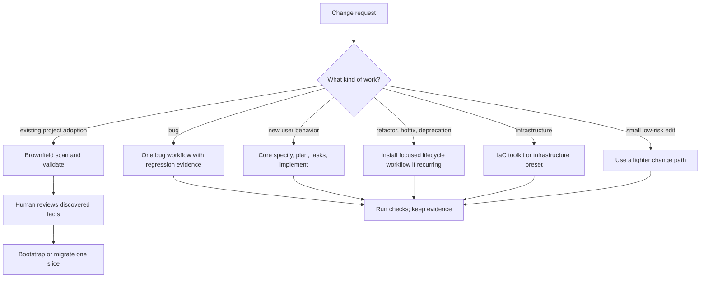
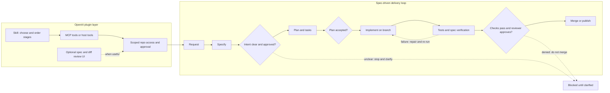

# Spec-Driven Development: lineage, tooling choices, and plugin fit

**Research briefing · 4 November 2026**  
Prepared from the collected repositories and first-party project documentation. “Spec Kit” means GitHub’s `github/spec-kit`; similar names and shared vocabulary are not treated as proof of ancestry.

## Executive readout

- **These repositories are not one family tree.** `spec-to-agents` adopted a Spec-Kit-style project workflow in September 2025. `agentic-sdlc-starter` is a later, independent Copilot prompt pipeline. The repositories have separate Git origins and the histories checked here do not establish a direct code lineage.
- **Spec Kit and SpecSwarm solve overlapping but different problems.** Spec Kit is a composable CLI and process toolkit with multiple agent integrations. SpecSwarm is a much more opinionated Claude Code development harness, with project memory, subagents, verification loops, scoring, and merge-oriented commands.
- **The AcroYoga example is not a .NET Agent Framework application.** It is a TypeScript/Next.js/PostgreSQL product built with Spec-Kit-shaped artifacts and Copilot agent files. Its checked-in production deployment targets Azure, but the development workflow and application can use other tools and providers.
- **Extensions should be selected by work type.** Brownfield analysis is useful when onboarding a real existing codebase; lifecycle workflows can help recurring work. Neither should be forced onto every change, and prompt instructions are not the same as tested automation.
- **A modern OpenAI plugin is a reasonable delivery format.** A skill can guide the stages; MCP or host tools can provide scoped repository access; approvals and validation gates should remain explicit.

## 1. Lineage: what is connected, and what is not

### The three named projects

| Repository | What it does | Evidence-based relationship |
| --- | --- | --- |
| [`github/spec-kit`](https://github.com/github/spec-kit/tree/v1.0.4) | GitHub’s Specify CLI, templates, agent integrations, and composable processes for specification-driven development. | The official project in this comparison. Its repository root is dated 21 August 2025 and the first implementation commit followed on 22 August. ([root](https://github.com/github/spec-kit/commit/fa2736371e077f55c4fe145fea186bab2561386d), [first implementation](https://github.com/github/spec-kit/commit/28fdfaa86973d4402eecd89ba6c87d31e1edae03)) |
| [`microsoft/spec-to-agents`](https://github.com/microsoft/spec-to-agents) | An event-planning multi-agent sample built with Microsoft Agent Framework. | Its repository shell was created one day before Spec Kit’s, but initially contained no application. Project scaffolding arrived on 28 August 2025; a 29 September commit titled “init spec-kit” added `.specify` templates, scripts, constitution material, prompts, and feature artifacts. That supports **adoption/customization**, not predecessor status. ([initial shell](https://github.com/microsoft/spec-to-agents/commit/a9c72e8f548048a15229b5baadab0e2bfbe4b87e), [scaffolding](https://github.com/microsoft/spec-to-agents/commit/363e39e9e69771b829ffa083030f83b8ba664993), [“init spec-kit”](https://github.com/microsoft/spec-to-agents/commit/fcf31cde1449299260e5ca0ccee1d5a118083aa4)) |
| [`microsoft/agentic-sdlc-starter`](https://github.com/microsoft/agentic-sdlc-starter) | A five-step prompt pipeline: assess PRD/TDD/user stories, resolve questions, specify, generate, validate. | Its initial implementation is dated 12 March 2026, months after Spec Kit began. Its README describes its own Copilot-centered pipeline and zero-assumption rules. No direct ancestry or adoption claim is established in the histories inspected. ([initial code](https://github.com/microsoft/agentic-sdlc-starter/commit/95eeaf19890249d2c1c6c1925fc768bf91bd4ab5), [README](https://github.com/microsoft/agentic-sdlc-starter/blob/main/README.md)) |

`spec-to-agents` is best read as a **software agent application that later added a Spec-Kit-style development process**. The application plans events: a coordinator routes work to venue, budget, catering, and logistics agents, with human input, search/weather/calendar tools, and Azure deployment. It is not itself a software lifecycle toolkit. ([README](https://github.com/microsoft/spec-to-agents/blob/main/README.md))

`agentic-sdlc-starter` is closer in purpose to Spec Kit because both structure software work before code generation. Its specific architecture is different: it consumes PRD/TDD/story files, inserts an assessor and resolver stage, then asks a generator to use only the derived specs and guardrails. That separation can reduce guesswork, but omissions in the generated spec also become omissions in the code agent’s input. ([pipeline and “specs only” rule](https://github.com/microsoft/agentic-sdlc-starter/blob/main/README.md))

The diagram uses dotted arrows for documented workflow adoption or specialization. The absence of a direct edge means the checked sources did not establish direct ancestry; it does not prove that no ideas ever influenced one another.

### The broader Spec-Kit-adjacent cluster

- The five-workflow [`spec-kit-extensions`](https://github.com/MartyBonacci/spec-kit-extensions) repository explicitly says its Claude Code users should look at SpecSwarm and that development focus moved there. This is the clearest documented relationship between the two community projects. It is a workflow/ecosystem relationship, not evidence that SpecSwarm is an official GitHub Spec Kit fork. ([README at collected snapshot](https://github.com/MartyBonacci/spec-kit-extensions/blob/08c2c341854f401a99669ebf389d4b73fee3f295/README.md))
- [`SpecSwarm`](https://github.com/MartyBonacci/specswarm) identifies itself as a Claude Code plugin for build, fix, modify, and ship workflows. Its collected repository is at `v7.19.3` (`f6de7c7`). ([README](https://github.com/MartyBonacci/specswarm/blob/f6de7c724477a8ef5fc884599d574ee74a370aa1/README.md))
- [`IBM/iac-spec-kit`](https://github.com/IBM/iac-spec-kit) is a domain-specific implementation for infrastructure-as-code work. Its README describes cloud-neutral principles and provider-specific plans, with examples for AWS, Azure, GCP, and IBM Cloud. It is a specialized toolkit, not a default extension every application team needs. ([README](https://github.com/IBM/iac-spec-kit/blob/41dfa05febe860acd076d9e75476527027bfa2f8/README.md))

## 2. SpecSwarm versus GitHub Spec Kit

### First define the comparison

The collected `spec-kit-official` source tree declares `specify-cli` version **1.0.4** in `pyproject.toml`. GitHub has since published **1.3.0** (3 November 2026), so counts below describe the supplied 1.0.4 source snapshot, not a claim about every file in the newest release. ([collected version file](https://github.com/github/spec-kit/blob/v1.0.4/pyproject.toml), [current release](https://github.com/github/spec-kit/releases/tag/v1.3.0))

The current Spec Kit README describes a toolkit of separate processes and reusable mechanisms: SDD in core, bug-fixing and assessment as installable extensions, and additional extension, preset, workflow, workflow-step, bundle, and catalog layers. SpecSwarm packages more of the lifecycle into one ready-to-run, Claude-specific harness. ([Spec Kit README](https://github.com/github/spec-kit/blob/v1.0.4/README.md), [SpecSwarm README](https://github.com/MartyBonacci/specswarm/blob/f6de7c724477a8ef5fc884599d574ee74a370aa1/README.md))

### Quantitative surface comparison

| Measure in collected source | GitHub Spec Kit 1.0.4 tree | SpecSwarm 7.19.3 tree |
| --- | ---: | ---: |
| Core command templates / plugin command files | 9 core command templates | 34 `/ss:*` command files |
| Optional command surface | 17 command Markdown files under bundled extensions in this checkout | Portable distribution has 23 command files; the plugin also has 10 skills and 6 agent definitions |
| Main abstraction | CLI bootstraps a project, then templates, integrations, and installed process components guide the agent | Claude Code plugin coordinates project context, agents, hooks, task checks, scoring, and shipping |
| Declared setup | Python 3.11+ and `uv`, then the Specify CLI and a supported coding agent | Claude Code plugin/marketplace or its Claude-oriented portable install; Git for branch operations |
| Default verification style | Stepwise workflow plus convergence and whatever installed checks/presets/workflows require | Per-task verification, adversarial spec checks, quality scoring, multi-agent review, and configurable gates |

The command counts are **file counts, not a quality score**. They are not perfectly comparable: Spec Kit intentionally separates core commands from extension commands, whereas SpecSwarm places its larger command surface inside one plugin. The SpecSwarm README describes five canonical user-facing commands (`init`, `build`, `fix`, `modify`, `ship`) plus optional autonomy and support commands. ([Spec Kit command templates](https://github.com/github/spec-kit/tree/v1.0.4/templates/commands), [Spec Kit bundled extensions](https://github.com/github/spec-kit/tree/v1.0.4/extensions), [SpecSwarm command tree](https://github.com/MartyBonacci/specswarm/tree/f6de7c724477a8ef5fc884599d574ee74a370aa1/plugins/ss/commands), [portable commands](https://github.com/MartyBonacci/specswarm/tree/f6de7c724477a8ef5fc884599d574ee74a370aa1/portable/commands/sw))

### Qualitative differences

| Dimension | GitHub Spec Kit | SpecSwarm |
| --- | --- | --- |
| **Best description** | A toolkit for choosing and composing agent-facing development processes. | A preassembled coding harness with strong defaults for Claude Code. |
| **Typical path** | Initialize → specify → clarify as needed → plan → tasks → implement → converge. Extend or customize when needed. | Initialize project knowledge → build/fix/modify → route tasks to agents → verify work → score/review → ship. `/ss:go` can walk a longer autonomous loop. |
| **Control and autonomy** | More explicit stage boundaries and choice of process components. Workflows can automate steps, but the user/team chooses the shape. | More integrated orchestration, background/watchdog/overnight features, and merge-oriented shipping. The higher automation can save coordination time and increases the need for tight branch protections, tool permissions, and review gates. |
| **Agent portability** | Designed for multiple coding-agent integrations. | Centered on Claude Code’s plugin, command, hook, and subagent model. The portable distribution is still presented for Claude Code. |
| **Project state** | Usually `.specify/` plus numbered feature artifacts under a project’s chosen `specs/` location. | `.specswarm/` stores feature artifacts, tech stack, quality rules, references, memory, and loop state. Its reference extraction can read an existing spec corpus, but teams should decide which location is canonical. |
| **Verification emphasis** | Convergence and process components can be tailored to project policy. | More built-in procedural checking: preflight, task verification queues, spec mentor, scoring, and multi-agent review. Numeric score and extra agents are useful signals, not proof that a product is correct. |

The graph makes the difference visible: Spec Kit exposes a composable process boundary; SpecSwarm embeds orchestration and shipping inside its command harness.

### Which I would choose

- Choose **GitHub Spec Kit** if you want the process to work across agent vendors, you want to assemble a smaller set of rules and extensions, or you need a toolkit that can fit different team governance.
- Choose **SpecSwarm** if your team standardizes on Claude Code and you value an integrated feature/fix/ship loop with more autonomous task routing and verification. Treat its commands as a harness with operational permissions, not merely reusable prompts.
- Avoid running both as competing sources of truth. If you combine them, choose one canonical spec directory and decide which system owns task state, branch creation, and merge decisions.

## 3. The AcroYoga sample: version, tooling, and portability

The directory name suggests a Next.js ecommerce API server, but the collected project describes itself as an **AcroYoga community/events platform** with event discovery, RSVPs, social features, teacher profiles, Stripe Connect, web and mobile workspaces, and Azure deployment. It is a full application, not just a Spec Kit demonstration. ([README at collected snapshot](https://github.com/microsoft/CommunityManagement-Sample-Spec-Kit/blob/8567dc09a5c5dbf7f73aee1090b05e20ee1a6a38/README.md))

### Which Spec Kit version?

The repository does **not** pin `specify-cli` and its `.specify/` tree has been edited as the project evolved. Its initial Spec-Kit initialization commit is dated 15 March 2026. The official `v0.3.0` release was published 13 March 2026, making **v0.3.0-era tooling the best-supported inference** for the original bootstrap. However, there is no installer lock, version stamp, or init-options record in the sample that proves the exact CLI release; treat “v0.3.0” as likely, not verified. ([sample initialization history](https://github.com/microsoft/CommunityManagement-Sample-Spec-Kit/commit/0cdfdd9), [Spec Kit v0.3.0 release](https://github.com/github/spec-kit/releases/tag/v0.3.0), [current sample `.specify` artifacts](https://github.com/microsoft/CommunityManagement-Sample-Spec-Kit/tree/8567dc09a5c5dbf7f73aee1090b05e20ee1a6a38/.specify))

### What it actually needs

| Goal | Needed tooling | Is .NET Agent Framework required? |
| --- | --- | --- |
| Continue the spec-driven workflow | The `.specify` templates/scripts and a coding agent that can read and update the project files. The supplied agent/prompt files target GitHub Copilot conventions. A pinned/current Specify CLI is useful for initializing or upgrading, but the existing artifacts are already in the repository. | **No.** Spec Kit is the workflow/template layer. The repository has no `.csproj`, `.sln`, or `Microsoft Agent Framework` application dependency. |
| Build/test the application locally | Node.js and npm for the workspaces; build the design-token package; Next.js/TypeScript toolchain; PGlite for in-memory PostgreSQL tests or a local PostgreSQL service for local integration. Project docs ask for Node 24, while `package.json` declares Node `>=22`. | **No.** The product stack is JavaScript/TypeScript, Next.js, React, PostgreSQL, and Expo/React Native. ([package manifest](https://github.com/microsoft/CommunityManagement-Sample-Spec-Kit/blob/8567dc09a5c5dbf7f73aee1090b05e20ee1a6a38/package.json), [devcontainer](https://github.com/microsoft/CommunityManagement-Sample-Spec-Kit/blob/8567dc09a5c5dbf7f73aee1090b05e20ee1a6a38/.devcontainer/devcontainer.json)) |
| Reproduce the checked-in production deployment | Azure CLI, Azure Developer CLI (`azd`), Docker, Azure subscription/resource permissions, GitHub Actions configuration and identity/secret setup. The repo supplies Bicep, `azure.yaml`, deployment workflows, and an Azure runbook. | **No.** Azure infrastructure is in Bicep and Actions; that does not introduce the .NET agent runtime. ([environment setup](https://github.com/microsoft/CommunityManagement-Sample-Spec-Kit/blob/8567dc09a5c5dbf7f73aee1090b05e20ee1a6a38/docs/environment-setup.md), [azd project](https://github.com/microsoft/CommunityManagement-Sample-Spec-Kit/blob/8567dc09a5c5dbf7f73aee1090b05e20ee1a6a38/azure.yaml), [Bicep entry point](https://github.com/microsoft/CommunityManagement-Sample-Spec-Kit/blob/8567dc09a5c5dbf7f73aee1090b05e20ee1a6a38/infra/main.bicep)) |

The **workflow is portable; this production deployment is Azure-shaped**. The current Bicep and runbooks target Azure Container Apps, Azure PostgreSQL Flexible Server, Blob Storage, Key Vault, Managed Identity, Front Door, and Azure OIDC in GitHub Actions. You can substitute another compute provider, but you must remap identity, database authentication, storage, secrets, network/CDN, IaC, and deployment automation. A target with containers, managed PostgreSQL, object storage, workload identity, secrets, and edge routing can preserve the design; code and deployment specifications will still need edits. ([deployment constitution and project docs](https://github.com/microsoft/CommunityManagement-Sample-Spec-Kit/tree/8567dc09a5c5dbf7f73aee1090b05e20ee1a6a38/specs), [Azure deployment workflow](https://github.com/microsoft/CommunityManagement-Sample-Spec-Kit/blob/8567dc09a5c5dbf7f73aee1090b05e20ee1a6a38/.github/workflows/deploy.yml))

### Difficulty and whether it is worth doing

These are **engineering estimates**, not measured project times. The scores assume a capable TypeScript team and count the scope of work, not model tokens.

| Undertaking | Difficulty | Why |
| --- | ---: | --- |
| Run the current tree locally without cloud deployment | 2/5 | The repo already has npm workspaces, a devcontainer, token build steps, PGlite tests, and environment docs. Some local configuration and dependency repair may still be needed. |
| Swap Copilot for another agent while keeping the application | 2/5 | The project artifacts and code stay; adapt command/integration files, context delivery, and review policy. |
| Rebuild the product from its specs on the same TypeScript/PostgreSQL stack | 4/5 | Many feature slices, shared UI/tokens, mobile, auth, payments, migrations, and CI/deployment behavior must all be recreated and verified. Expect weeks, not a weekend. |
| Replatform production from Azure to another provider while keeping behavior | 4/5 | Identity, database auth, object storage, infrastructure, secrets, deploy/rollback flows, and operational docs are provider-specific. |
| Rebuild both product and production platform from scratch on another stack/provider | 5/5 | It combines application parity, security and payment review, data migration, operational behavior, and new infrastructure. |

**Worth it:** yes for a controlled benchmark—rebuild one vertical slice to compare agent/workflow quality, or port a specific Azure boundary to validate provider independence. **Usually not worth it** to regenerate the whole existing product merely to prove Spec Kit works: the code and specs already form a reference baseline. Reuse the implementation and migrate the provider-specific edges unless full reimplementation is itself the research question.

## 4. Extensions: useful by need, harmful by default

### Brownfield scan/bootstrap/validate/migrate

The community Brownfield extension defines four commands. Its design is sensible: scan and validate are specified as read-only; bootstrap and migrate write project artifacts; the README says to show a plan and wait for approval before those writes. It also calls out drift, module boundaries, and missing tests. ([README](https://github.com/Quratulain-bilal/spec-kit-brownfield/blob/7479c5206a573e95890cbc252dd30806121a44bb/README.md), [`extension.yml`](https://github.com/Quratulain-bilal/spec-kit-brownfield/blob/7479c5206a573e95890cbc252dd30806121a44bb/extension.yml), [scan command](https://github.com/Quratulain-bilal/spec-kit-brownfield/blob/7479c5206a573e95890cbc252dd30806121a44bb/commands/speckit.brownfield.scan.md))

**Assessment: high potential for brownfield onboarding; modest assurance from the supplied implementation.** The core behaviors are prompt instructions, and the repository contains no dedicated test suite. A model can misread generated code, omit an uncommon module, or infer a requirement that tests never guarantee. Treat its project profile as a cited hypothesis; review discovered facts before bootstrap, and migrate one feature at a time. A validation command helps, but a prompt saying “verify” is not a deterministic architecture proof.

### Bugfix / modify / refactor / hotfix / deprecate

The second extension collection supplies five lifecycle paths, templates, commands, and helper scripts. It is valuable where those activities recur and the team wants consistent impact checks, regression tests, refactor baselines, emergency notes, and staged deprecation. Its own README says the project is shifting its Claude Code focus to SpecSwarm. ([README](https://github.com/MartyBonacci/spec-kit-extensions/blob/08c2c341854f401a99669ebf389d4b73fee3f295/README.md), [workflow docs](https://github.com/MartyBonacci/spec-kit-extensions/tree/08c2c341854f401a99669ebf389d4b73fee3f295/extensions/workflows))

**Assessment: useful patterns, uneven portability and mechanical assurance.** The scripts use shell heuristics and assume layouts such as `specs/`, `app/`, `tests/`, and particular import forms; the refactor metrics helper expects Node/npm conventions. That is adaptable for matching repos, but it is not a language-independent impact graph. I found no dedicated automated test suite in the supplied extension tree. The repository’s installation guide also targets Spec Kit `v0.0.18+` and manual file copying, so check current extension packaging and command conventions before installing it unchanged. ([installation guide](https://github.com/MartyBonacci/spec-kit-extensions/blob/08c2c341854f401a99669ebf389d4b73fee3f295/INSTALLATION.md), [refactor metrics helper](https://github.com/MartyBonacci/spec-kit-extensions/blob/08c2c341854f401a99669ebf389d4b73fee3f295/extensions/workflows/refactor/measure-metrics.sh), [dependency scanner](https://github.com/MartyBonacci/spec-kit-extensions/blob/08c2c341854f401a99669ebf389d4b73fee3f295/extensions/workflows/deprecate/scan-dependencies.sh))

### IBM IaC Spec Kit

This is a separate infrastructure-specialized toolkit with an `iac-specify-cli`, IaC templates, Terraform-oriented guidance, and examples for multiple clouds. Its README describes the project as experimental and says the toolkit leans toward Terraform while allowing other IaC tools. That makes it a good starting point for infrastructure specs, not a required add-on for application development. ([README](https://github.com/IBM/iac-spec-kit/blob/41dfa05febe860acd076d9e75476527027bfa2f8/README.md), [CLI metadata](https://github.com/IBM/iac-spec-kit/blob/41dfa05febe860acd076d9e75476527027bfa2f8/pyproject.toml))

### Recommendation

Do **not** install all extensions by default. Classify work first, then load the narrowest process that improves evidence or safety:

| Work type | Recommended path |
| --- | --- |
| New user behavior | Core specify → plan → tasks → implement → verify/converge. |
| Bug | A bug-specific workflow with reproduction and regression-test evidence. Current Spec Kit already packages an optional first-party bug extension, so avoid installing a second bug command set without a clear reason. ([official bug workflow](https://github.com/github/spec-kit/tree/v1.0.4/extensions/bug)) |
| Existing codebase onboarding | Brownfield scan and validation first; approve bootstrap output; migrate one representative feature and inspect the result before scaling. |
| Refactor, hotfix, deprecation | Add focused workflows if these changes recur or your risk policy requires them. Keep emergency steps lean enough to use under pressure. |
| Infrastructure | Use an IaC-specific toolkit or project preset when cloud-resource changes are a real workload. |
| Small, low-risk edit | Use a light path. Requiring full spec/plan/task artifacts for every one-line correction adds ceremony and can make people bypass the process. |

Useful additions when there is real need: a small-change/large-change router; machine-checkable spec-to-test traceability; explicit migration/rollback gates; and dependency/security remediation workflows. Prefer Spec Kit’s extension, preset, and workflow composition model over globally copying every command into every repository. ([customization guidance](https://github.github.io/spec-kit/how-to/customization.html), [extensions overview](https://github.github.io/spec-kit/extensions/overview.html))

## 5. Could this be an OpenAI plugin?

**Yes—especially as a modern ChatGPT/Codex plugin, not as a monolithic replacement for the coding environment.** OpenAI’s plugin format supports skills, MCP servers, and optional UI. Skills explain which tools to call and in what order; MCP tools supply scoped data/actions; a UI is useful when a person needs to inspect or approve a spec or diff. A skills-only plugin is also valid when host tools already provide repository access. ([plugin architecture](https://developers.openai.com/plugins/concepts/plugins), [skills](https://developers.openai.com/plugins/concepts/skills), [MCP servers](https://developers.openai.com/plugins/concepts/mcp-server))

A practical package could provide:

- A **spec-driven skill** that classifies the change and walks through specify, clarify, plan, implement, and convergence.
- Optional skills for **bug triage**, **brownfield onboarding**, **refactoring**, and **IaC**, rather than forcing all workflows into the default path.
- Narrow tools such as `read_project_context`, `draft_spec`, `validate_spec`, `read_ci_status`, and `prepare_patch`. Each tool should declare inputs, scope, authentication, and side effects accurately.
- An optional review view for requirement-to-test links or the proposed diff. Writes, merge, push, and deploy should be separately gated.

The workflow still needs a repository context and execution environment. In Codex, local tools may already provide those. A ChatGPT plugin using a remote MCP server needs a connected repository service or another explicitly authorized data source; packaging prompt templates alone does not grant local filesystem access or run the project’s tests. OpenAI’s plugin guidance calls for clear tool behavior, access controls, and accurate side-effect descriptions. Plugins that rely on lifecycle hooks also have a distribution constraint: the docs say hook-containing plugins are not eligible for the public plugin directory, and installing a plugin on the web does not install local hook scripts. ([plugin packaging and hooks](https://developers.openai.com/plugins/build/plugins), [plugin guidelines](https://developers.openai.com/plugins/plugin-guidelines))

The key is to make each stage a reviewable artifact and stop on unresolved or failed gates. A tool call can write a file; the plugin should not silently interpret that as approval to implement, merge, or deploy.

## 6. Sources, method, and version notes

This is a source comparison, not a benchmark of coding quality. Claims about product intent come from each project’s README/docs; chronology comes from repository commits/releases; quantitative command counts are derived from the checked-in file trees. The Mermaid tool’s static linter accepted all five diagrams against its 11.16.1 compatibility profile. That is static evidence, not a full Mermaid render in GitHub or another Markdown host.

| Collected repository | Local snapshot analyzed |
| --- | --- |
| `spec-kit-official` | Commit `a227e383`; `pyproject.toml` declares `1.0.4`. Upstream release page now lists `1.3.0`. |
| `specswarm` | Commit `f6de7c7`, tag `v7.19.3`. |
| `agentic-sdlc-starter` | Commit `904ca91`. |
| `spec-to-agents` | Commit `f40268f`. |
| AcroYoga sample | Commit `8567dc0`. |
| Brownfield extension | Commit `7479c52`, extension version `1.0.0`. |
| Bugfix/lifecycle extension | Commit `08c2c34`. |
| IBM IaC Spec Kit | Commit `41dfa05`, latest local tag `v0.0.12`. |

The example version inference is deliberately limited: the original bootstrap commit is close in time to Spec Kit `v0.3.0`, but the application does not preserve a CLI version pin. The lineage conclusion is likewise limited to the histories inspected; it distinguishes “no direct ancestry evidence found” from “no influence existed.”

